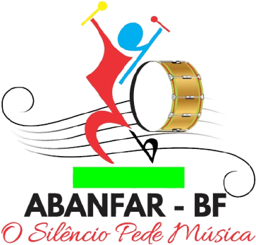

# ABANFAR – BF  
## *O Silêncio Pede Música*



Sistema web desenvolvido em **Django** para gerenciamento da escola de música **ABANFAR – BF**, oferecendo ferramentas para organização de professores, ensaios, alunos e atividades internas.

---

## 🚀 Tecnologias Utilizadas
- Python 3.11+
- Django 5
- Bootstrap 5
- HTML & CSS
- SQLite3
- Git & GitHub

---

## 📌 Funcionalidades

### 🔐 Autenticação
- Login e logout
- Proteção de páginas
- Painel restrito

### 👨‍🏫 Professores
- Cadastro
- Edição
- Exclusão
- Listagem completa

### 🥁 Ensaios
- Registro de ensaios
- Relacionamento com professor

### 👥 Alunos *(em desenvolvimento)*
- Cadastro
- Listagem

### 📚 Cursos e Turmas *(em desenvolvimento)*

---
### 📁 Estrutura do Projeto
```
meu_projeto/
│
├── pasta1/
│   ├── arquivo1.py
│   └── arquivo2.py
│
├── pasta2/
│   ├── subpasta/
│   │   └── arquivo3.py
│   └── arquivo4.py
│
└── manage.py
```


---

## ⚙️ Como Rodar o Projeto

### 1️⃣ Clone o repositório

```
git clone https://github.com/JadsonTSI/abarfar.git
```
```
cd abarfar
```


### 2️⃣ Crie e ative o ambiente virtual
```
python -m venv venv
```
```
venv/Scripts/activate # Windows
```
```
source venv/bin/activate # Linux/macOS
```

### 3️⃣ Instale as dependências
```
pip install -r requirements.txt
```


### 4️⃣ Rode as migrações
```
python manage.py migrate
```


### 5️⃣ Crie um usuário administrador
```
python manage.py createsuperuser
```


### 6️⃣ Inicie o servidor
```
python manage.py runserver
```


Acesse:  
```
http://127.0.0.1:8000/
```

---

## 🛠️ Roadmap

- Área do aluno  
- Controle de presença  
- Notas e desempenho  
- Dashboard administrativo  
- API REST  
- Exportação de relatórios PDF  

---

## 🧪 Testes e Cobertura de Código

O projeto conta com uma suíte abrangente de testes automatizados e medição de cobertura de código.

### 1️⃣ Ativação do Ambiente Virtual (venv)
Antes de rodar os testes, ative o ambiente virtual na pasta raiz do projeto:
```powershell
# Windows (PowerShell)
.\venv\Scripts\Activate.ps1

# Windows (CMD)
.\venv\Scripts\activate.bat

# Linux/macOS
source venv/bin/activate
```

### 2️⃣ Execução dos Testes com Pytest
O `pytest` está configurado no arquivo `pytest.ini` para coletar e rodar todos os testes do Django de maneira eficiente:
```bash
# Executar todos os testes
python -m pytest

# Executar de forma detalhada (mostrando cada caso de teste)
python -m pytest -v

# Executar os testes de um app específico (ex: contas)
python -m pytest contas/
```

### 3️⃣ Medição de Cobertura de Código (Coverage)
O `coverage` analisa quais partes e linhas do código foram exercitadas pelos testes executados.

*   **Coletar os dados de cobertura executando o pytest:**
    ```bash
    coverage run -m pytest
    ```
*   **Gerar relatório simples no terminal:**
    ```bash
    coverage report
    ```
*   **Gerar relatório mostrando as linhas não cobertas:**
    ```bash
    coverage report -m
    ```
*   **Gerar relatório interativo em HTML:**
    ```bash
    coverage html
    ```
    Isso gerará uma pasta `htmlcov/` no seu diretório. Abra o arquivo `htmlcov/index.html` em qualquer navegador para ver o relatório interativo completo.
*   **Limpar os dados de cobertura coletados anteriormente:**
    ```bash
    coverage erase
    ```

---

## 👤 Autor

**Jadson Leitão**  
Estudante de Sistemas para Internet • Desenvolvedor Django  

---

